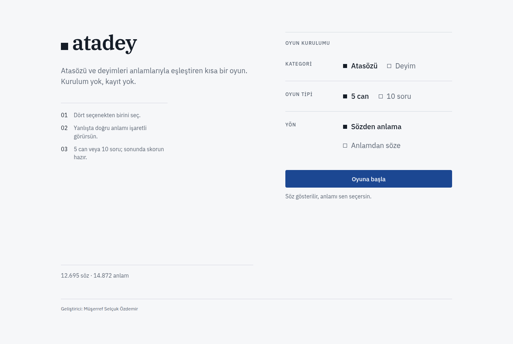
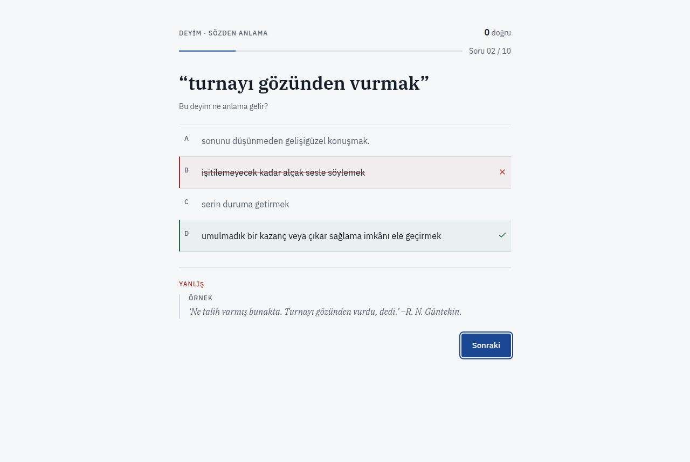
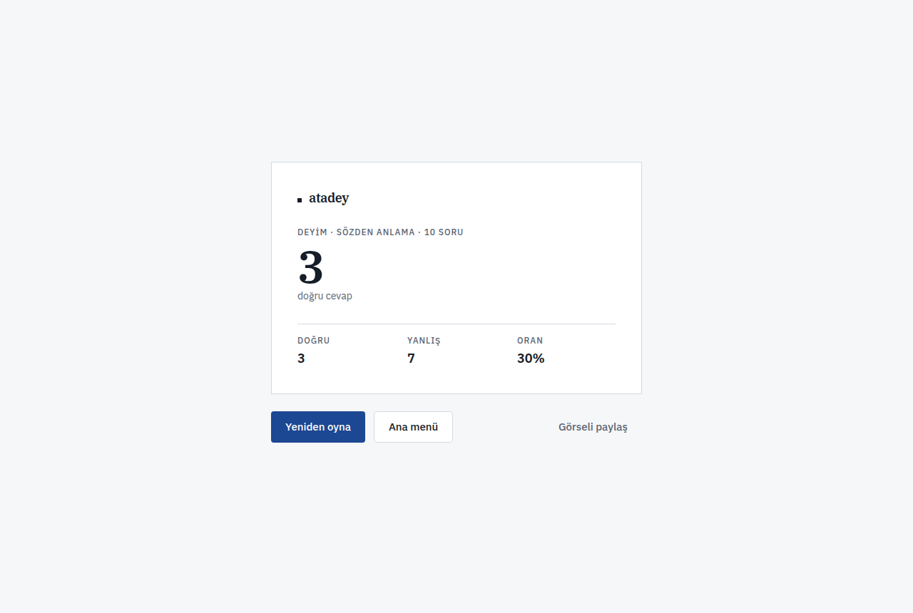
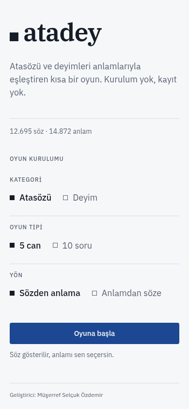

# AtaDey — Atasözü ve Deyim Oyunu

<div align="center">

[](https://github.com/SelcukOzdemir23/atadey/actions/workflows/ci.yml)
[](LICENSE)
[](https://selcukozdemir23.github.io/atadey/)

</div>

Türkçe atasözü ve deyimleri anlamlarıyla eşleştiren, tarayıcıda çalışan bir bilgi
oyunu. Kurulum yok, sunucu yok, hesap yok: sayfa açılır, oyun başlar.

| Menü | Oyun |
| --- | --- |
|  |  |

| Sonuç | Menü (mobil) |
| --- | --- |
|  |  |

## Nasıl oynanır

Üç seçim yapılır ve oyun başlar:

| Seçim | Seçenekler |
| --- | --- |
| **Kategori** | Atasözü · Deyim |
| **Oyun tipi** | 5 can (5 yanlışta biter) · 10 soru |
| **Yön** | Sözden anlama · Anlamdan söze |

Her soruda dört seçenekten biri doğrudur. Cevaptan sonra doğru anlam, varsa
kullanım örneğiyle birlikte gösterilir; örnek yoksa satır hiç basılmaz. Oyun
sonunda skorun görseli indirilebilir veya panoya kopyalanabilir.

## Veri

- **2.255 atasözü** ve **10.440 deyim**: toplam 14.872 anlam.
- Kaynak: `data/raw/*.csv` içindeki kazınmış sözlük dökümü. Kökeni ve lisans
  notu için [data/raw/SOURCE.md](data/raw/SOURCE.md).
- `public/data/*.json` **elle düzenlenmez**. Hepsi `npm run data:build` ile
  üretilen, sıralaması ve baytları sabit çıktılardır; CI `npm run data:check`
  ile doğrular. Kurallar: [docs/DATA.md](docs/DATA.md).

Soru üretimi tek bir kurala dayanır: bir sözün yalnızca birincil anlamı
veri kümesinde tek bir söze aitse o söz sorulabilir. Böylece hiçbir soruda iki
seçenek doğru olamaz.

## Özellikler

- İki kategori × iki oyun tipi × iki yön.
- Her soru dört farklı seçenek ve tek doğru cevap; anlamsız/kısaltma seçenek yok.
- Cevaptan sonra yalnızca **yeni** bilgi: varsa kullanım örneği ve diğer anlamlar.
- Klavye: `1–4` ile cevapla, `Enter` ile ilerle; cevap sonrası odak “Sonraki”de.
- Ekran okuyucu için `aria-live` duyurusu (ör. “Yanlış. Doğru cevap: …”).
- Tamamen istemci tarafı; sunucu, hesap, çerez ve izleme betiği yok.
- Yazı tipleri kendi barındırılıyor; sayfa açılırken üçüncü tarafa istek gitmiyor.
- Sonucu PNG olarak paylaşma (pano veya indirme).

## Kurulum

Node 20+ gerekir (`.nvmrc` → 22).

```bash
npm ci
npm run dev
```

Uygulama GitHub Pages alt yolunda yayınlandığı için geliştirme sunucusu da
kök dizinden değil alt yoldan açılır: **http://localhost:5173/atadey/**

## Komutlar

| Komut | Ne yapar |
| --- | --- |
| `npm run dev` | Geliştirme sunucusu (`/atadey/`) |
| `npm run build` | Tip kontrolü + üretim derlemesi |
| `npm run preview` | Derlemeyi yerel olarak sunar |
| `npm test` | Testler (veri kalite testleri dahil) |
| `npm run test:coverage` | Kapsam raporu |
| `npm run lint` | ESLint |
| `npm run typecheck` | `tsc --noEmit` |
| `npm run data:build` | Ham CSV'lerden `public/data` üretir |
| `npm run data:check` | Üretilmiş veri güncel mi, doğrular |

## Proje yapısı

```
data/raw/        Ham CSV'ler + kaynak notu (elle düzenlenir)
public/data/     Üretilen JSON + manifest (elle düzenlenmez)
scripts/         Veri hattı
src/components/  Arayüz bileşenleri
src/dataLoader.ts  Veri yükleme ve soru üretimi
src/test/        Davranış ve veri kalitesi testleri
docs/            Tasarım, veri ve mimari notları
```

- Mimari: [docs/ARCHITECTURE.md](docs/ARCHITECTURE.md)
- Tasarım sistemi: [docs/DESIGN.md](docs/DESIGN.md) — “Fihrist”: IBM Plex
  Serif/Sans, tek vurgu rengi, 4px yarıçap, hairline çizgiler.
- Veri hattı: [docs/DATA.md](docs/DATA.md)

## Katkı

Hata bildirimi ve öneriler için issue açabilirsin; kod katkısı için
[CONTRIBUTING.md](CONTRIBUTING.md) içindeki kısa listeye bak.

## Lisans

Kod MIT lisanslıdır ([LICENSE](LICENSE)). Oyun verisi kazınmış bir sözlük
dökümünden gelir ve kendi kaynak notuna tabidir: bu veriyi proje dışında
kullanmadan önce [data/raw/SOURCE.md](data/raw/SOURCE.md) dosyasını oku.

Geliştirici: [Müşerref Selçuk Özdemir](https://github.com/SelcukOzdemir23)
